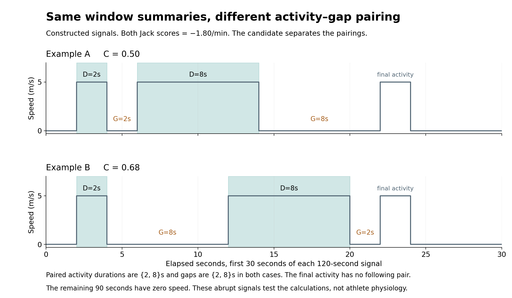

# Movement metrics

Two per-recording features and a small reproducible comparison. This work adds
measurement functions and examples. It does not train a prediction model or
change the website.

## Features

**Jack's original metric** (`jack_metric.py`) keeps the current formula. In each
complete 30-second window it measures maximum positive change in GPS speed per
second, longest activity above 4.44 m/s, and occupied 5 m grid cells. It scales
each component within the recording, fits a slope against elapsed minutes, and
adds the three slopes. The result describes movement trends in normalized
units per minute. The implementation is unchanged from the checked pilot.

**Activity-gap concentration** (`pair_metric.py`) is a proposed additional
feature. For a retained activity of duration `D`, let `G` be the time from its
end to the start of the next retained activity in the same usable block.

```python
local_fraction = D / (D + G)
score = sum(D * local_fraction) / sum(D)
```

This gives longer activities more weight. It is dimensionless and bounded by
0 and 1. It is not a readiness probability or a validated fatigue measure.
Uniformly scaling every duration and gap leaves it unchanged. Reordering
intact pairs also leaves it unchanged.

The candidate uses the same complete-window and speed/coordinate validity
rules as Jack's calculation. It retains runs strictly above 4.44 m/s lasting
at least 1 second. Adjacent complete windows remain connected. Missing or
excluded time breaks the block. Boundary-clipped activities are conservatively
excluded from pairs, and the final activity has no invented following gap.
Short excluded fast runs may occur inside `G`, so it must not be called rest
or recovery time. No eligible pair produces `None`, not zero.

## Run the examples

Python 3.10+ is required. From the repository root:

```bash
python -m pip install -r _2_metrics/requirements.txt
python _2_metrics/test_pair_metric.py
python _2_metrics/compare_metrics.py
python _2_metrics/plot_pairs.py
```

The default comparison uses the included small real summary tables and creates
two synthetic signals. It does not download or require the full dataset.
The plot script writes PNG/PDF figures in this directory.

To verify extraction from the same real file, provide that Parquet explicitly:

```bash
python _2_metrics/compare_metrics.py --parquet path/to/the/same/record.parquet
```

To compute either feature for another selected file, call the functions from
this directory (or add `_2_metrics` to your Python module path):

```python
from jack_metric import generate_metric
from pair_metric import generate_pair_metric

jack_score = generate_metric("record.parquet")
pair_score = generate_pair_metric("record.parquet")
```

`activity_gap_pairs(table)` also returns the timestamped pairs and coverage
metadata. Keep those alongside a scalar when investigating its meaning.

## Example results

| Case | Jack metric (/min) | Pair score | Pair count |
| --- | ---: | ---: | ---: |
| Team A, August 3, 2020 | -0.0000742763 | 0.0207355721 | 4 |
| Constructed A: (2,2), (8,8) seconds | -1.80 | 0.50 | 2 |
| Constructed B: (2,8), (8,2) seconds | -1.80 | 0.68 | 2 |

The real case has 104 complete windows out of 108, covering 3,120 usable
seconds, and five retained activities. Training boundaries remain unconfirmed.
Four pairs illustrate calculation, not stable predictive performance.

The two artificial 120-second signals have identical 30-second component
tables for Jack's metric. Their activity durations and following gaps have
the same marginal distributions, but different pairings. The final activity
is unpaired. These abrupt signals test the calculations, not athlete physiology.



## Files and checks

- `pair_metric.py`: candidate formula and activity extraction.
- `jack_metric.py`: unchanged original metric and shared preprocessing.
- `compare_metrics.py`: shared-input comparison and example generation.
- `test_pair_metric.py`: six grouped regression checks, including missing
  time, short excluded runs, window boundaries and terminal activities.
- `plot_pairs.py`: real pair contributions and constructed timelines.
- `comparison.csv` / `comparison.json`: scores, pairs and comparison checks.
- `real_*.csv` / `synthetic_*.csv`: small inputs and intermediate tables.
- `extraction_record.json` / `input_provenance.json`: source identity,
  checksums, coverage rules, commands and tested package versions.
- `pair_test_results.json`: regression results.

The raw recording and source archives are not included. The two metrics
capture different properties and their numeric scales should not be compared
directly. Future predictive comparison would need common eligible dates, the
same target, model family and temporal split.

The original formula comes from ASTRID proposal Section 3.1, Eq. 1. The
[SoccerMon data descriptor](https://doi.org/10.1038/s41597-024-03386-x)
uses 4.44 m/s in its high-speed distance example. The paired formula,
one-second retention and remaining pilot policies are provisional project
choices.
